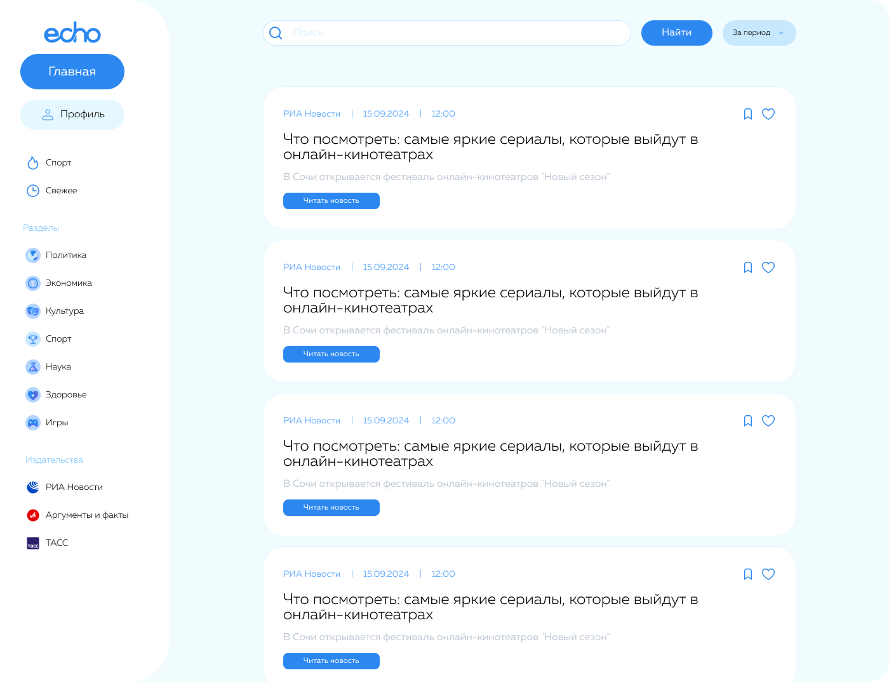
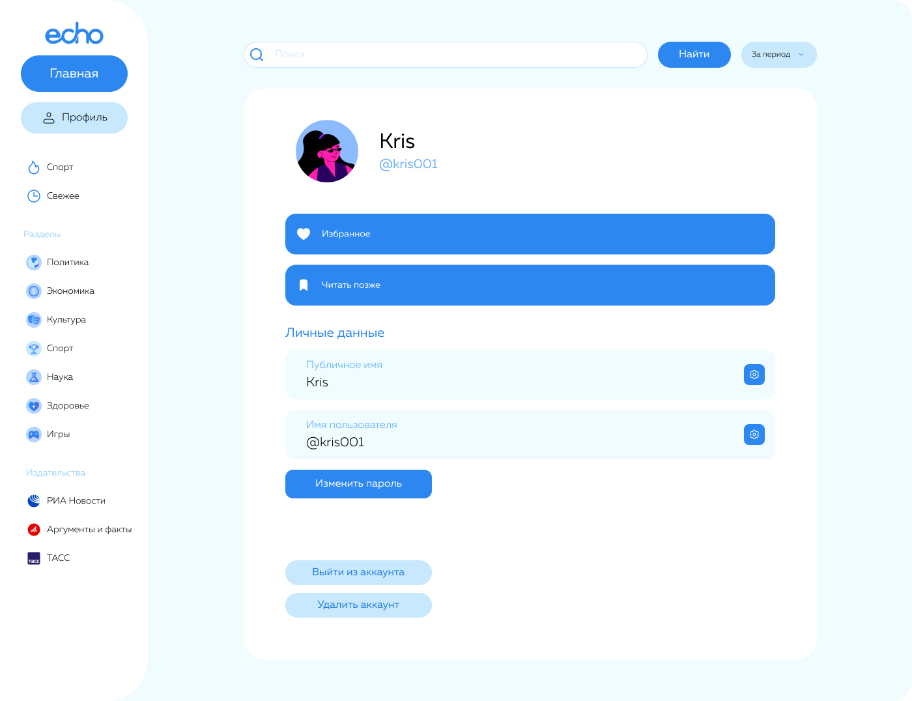

### Как запустить приложение

1. Откройте терминал в папке проекта и введите следующие команды по порядку:
   ```bash
   pip install -r requirements.txt
   ```
   ```bash
   python create_db.py
   ```
      ```bash
   python main.py
   ```

# 📰 Echo News

Это десктопное приложение для чтения новостей, которое автоматически собирает свежие статьи с ведущих новостных порталов (РИА Новости, Аргументы и Факты, ТАСС). 

Приложение позволяет фильтровать новости по категориям и издательствам, искать статьи по ключевым словам, а также сохранять понравившиеся материалы в список «Избранное» или «Читать позже».

| Главное окно (Лента новостей) | Профиль пользователя |
| :---: | :---: |
|  |  |


| Регистрация этап 1 | Регистрация этап 2 | Регистрация этап 3 |
| :---: | :---: | :---: |
|  |  |  |

## 🛠 Технологии и архитектура

*   **Язык:** Python 3.12
*   **Интерфейс:** PyQt5
*   **Парсинг:** Requests, BeautifulSoup4
*   **База данных:** SQLite3
*   **Работа с изображениями:** Pillow (PIL)

### Структура проекта:
```text
echo-news-app/
│
├── create_db.py           # Скрипт создания и заполнения БД
├── main.py                # Главный исполняемый файл
├── requirements.txt       # Список зависимостей
│
├── data/                  # База данных SQLite (игнорируется Git)
│   └── echo_database.db
│
├── assets/                # Ресурсы (картинки, иконки)
│   ├── avatars/           # Аватарки пользователей
│   ├── categories/        # Иконки категорий
│   ├── icons/             # Иконки интерфейса
│   └── publish/           # Логотипы издательств
│
├── src/                   # Исходный код
│   ├── config.py          # Настройка путей
│   ├── core/              # Работа с БД и утилиты
│   ├── parsers/           # Парсеры новостных сайтов (РИА, АиФ, ТАСС)
│   └── gui/               # Интерфейс (окна, виджеты)
│
└── about/                 # Скриншоты и документация
```

*Приложение создано в учебных целях. Все новости принадлежат их правообладателям (РИА Новости, АиФ, ТАСС).*
